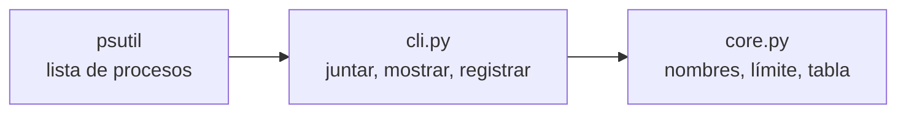

<div align="center">

<picture>
  <source media="(prefers-color-scheme: dark)" srcset="assets/logo-dark.svg">
  
</picture>

# emumon

**Detectá la fuga de memoria de un emulador Android antes de que te congele la computadora.**

Un monitor de consola chiquito para BlueStacks, LDPlayer, Nox, MEmu y `adb`: una tabla en vivo
de memoria y procesador, y una línea en un registro cada vez que un proceso pasa tu límite.

[](https://github.com/bbenedev/emumon/actions/workflows/ci.yml)


[Por qué](#por-qué) · [Instalar](#instalar) · [Uso](#uso) · [Cómo funciona](#cómo-funciona)

[English](README.md) · **Español**

</div>

---

## Por qué

Los emuladores que quedan abiertos durante horas, para pruebas automáticas o sesiones largas,
pueden ir ocupando cada vez más memoria hasta que toda la computadora se pone lenta. Medí una
instancia que llegó a 17 GB en una noche. El administrador de tareas lo muestra solo si lo
estás mirando. emumon vigila por vos y deja registrado a qué hora pasó.

## Instalar

```bash
git clone https://github.com/bbenedev/emumon
cd emumon
pip install .
```

Python 3.10 o más nuevo. La única dependencia es [psutil](https://pypi.org/project/psutil/).

## Uso

```bash
emumon                              # tabla en vivo cada 10 s, alerta arriba de 2000 MB
emumon --limit-mb 4000 --interval 5
emumon --targets "bluestacks,nox"   # solo estos nombres (parte del nombre, sin importar mayúsculas)
emumon --once                       # una sola revisión y sale, para scripts y tareas programadas
```

Salida real de `emumon --once`. En ese momento no había ningún emulador abierto, así que esta
ejecución vigila procesos de Python (`--targets python --limit-mb 100`):

```text
PROCESS                      PID    RAM MB   CPU %
python.exe                 20928      92.6     0.0
python.exe                 22064      22.5     7.1
python.exe                 26244       4.1     0.0
python.exe                 20860       1.0     0.0
TOTAL                                120.2
```

Un proceso que pasa el límite lleva `<< ALERT` al final de su fila, y suma una línea en
`~/.emumon/alerts.log` (se cambia con `--log-file`). El formato es este:

```text
2026-10-21 09:14:02,311 WARNING HD-Player.exe (pid 8120) is using 3120 MB, above the 2000 MB limit
```

| Opción | Por defecto | Qué hace |
|---|---|---|
| `--limit-mb` | `2000` | Alerta arriba de esta memoria en uso |
| `--interval` | `10` | Segundos entre revisiones |
| `--targets` | `bluestacks,hd-player,ldplayer,nox,memu,adb` | Partes de nombres de procesos a vigilar |
| `--once` | apagado | Revisa una vez y sale con código 0 |
| `--log-file` | `~/.emumon/alerts.log` | Dónde se agregan las alertas |

## Cómo funciona



- `core.py` es lógica pura: reconocer nombres, encontrar los procesos que pasan el límite y
  armar la tabla. Se prueba sin ningún emulador.
- El procesador se mide durante un instante corto, porque el primer valor que psutil da para
  un proceso siempre es 0.
- Un proceso justo en el límite no es una alerta; apenas arriba, sí. Los dos casos tienen
  prueba.
- Los procesos que se cierran o niegan el acceso durante una revisión se saltean en vez de
  cortar el programa.

## Pruebas

```bash
pip install -e ".[dev]"
pytest
```

La CI corre las pruebas, el revisor de código y el de formato en Python 3.10, 3.12 y 3.13.

## Licencia

[MIT](LICENSE)
