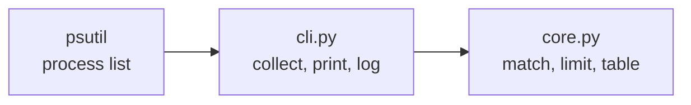

<div align="center">

<picture>
  <source media="(prefers-color-scheme: dark)" srcset="assets/logo-dark.svg">
  
</picture>

# emumon

**Catch an Android emulator's memory leak before it freezes your machine.**

A tiny command line monitor for BlueStacks, LDPlayer, Nox, MEmu and `adb`: a live table of
memory and CPU, and a log line every time a process goes over your limit.

[](https://github.com/bbenedev/emumon/actions/workflows/ci.yml)


[Why](#why) · [Install](#install) · [Usage](#usage) · [How it works](#how-it-works)

**English** · [Español](README.es.md)

</div>

---

## Why

Emulators left running for hours, for automated tests or long sessions, can keep growing in
memory until the whole computer slows down. I measured one instance reach 17 GB overnight.
The task manager shows it only if you are looking. emumon watches for you and leaves a record
with the time it happened.

## Install

```bash
git clone https://github.com/bbenedev/emumon
cd emumon
pip install .
```

Python 3.10 or newer. The only dependency is [psutil](https://pypi.org/project/psutil/).

## Usage

```bash
emumon                              # live table every 10 s, alert above 2000 MB
emumon --limit-mb 4000 --interval 5
emumon --targets "bluestacks,nox"   # only these names (substring, any case)
emumon --once                       # one scan and exit, for scripts and scheduled tasks
```

Real output of `emumon --once`. No emulator was open at the time, so this run watches Python
processes instead (`--targets python --limit-mb 100`):

```text
PROCESS                      PID    RAM MB   CPU %
python.exe                 20928      92.6     0.0
python.exe                 22064      22.5     7.1
python.exe                 26244       4.1     0.0
python.exe                 20860       1.0     0.0
TOTAL                                120.2
```

A process over the limit gets `<< ALERT` at the end of its row, and a line in
`~/.emumon/alerts.log` (change it with `--log-file`). The format looks like this:

```text
2026-10-21 09:14:02,311 WARNING HD-Player.exe (pid 8120) is using 3120 MB, above the 2000 MB limit
```

| Option | Default | Meaning |
|---|---|---|
| `--limit-mb` | `2000` | Alert above this resident memory |
| `--interval` | `10` | Seconds between scans |
| `--targets` | `bluestacks,hd-player,ldplayer,nox,memu,adb` | Process name fragments to watch |
| `--once` | off | Scan once and exit with code 0 |
| `--log-file` | `~/.emumon/alerts.log` | Where alerts are appended |

## How it works



- `core.py` is pure logic: matching names, finding processes over the limit, building the
  table. It is tested without any emulator.
- CPU is sampled over a short window, because the first value psutil reports for a process is
  always 0.
- A process exactly at the limit is not an alert; just above it is. Both cases are tested.
- Processes that close or deny access during a scan are skipped instead of crashing the loop.

## Tests

```bash
pip install -e ".[dev]"
pytest
```

CI runs the tests, the linter and the formatter check on Python 3.10, 3.12 and 3.13.

## License

[MIT](LICENSE)
